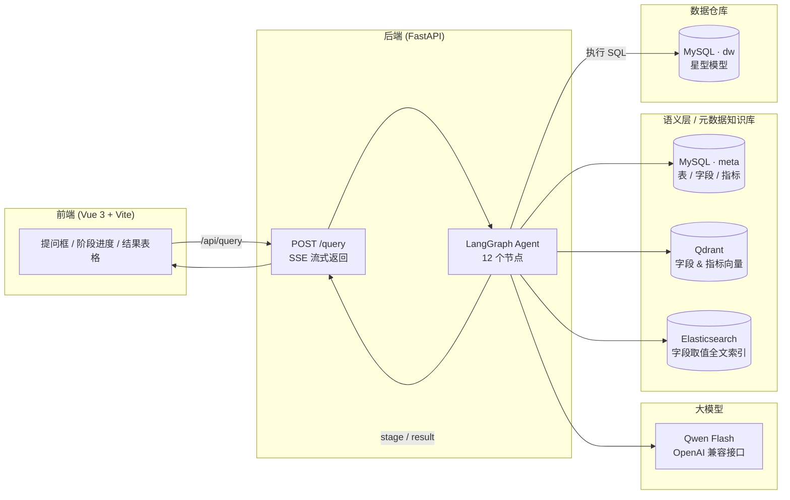
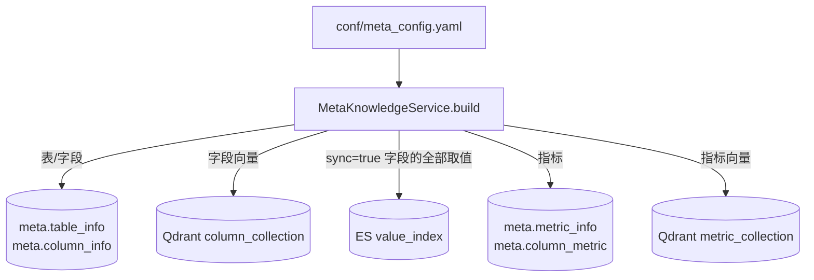
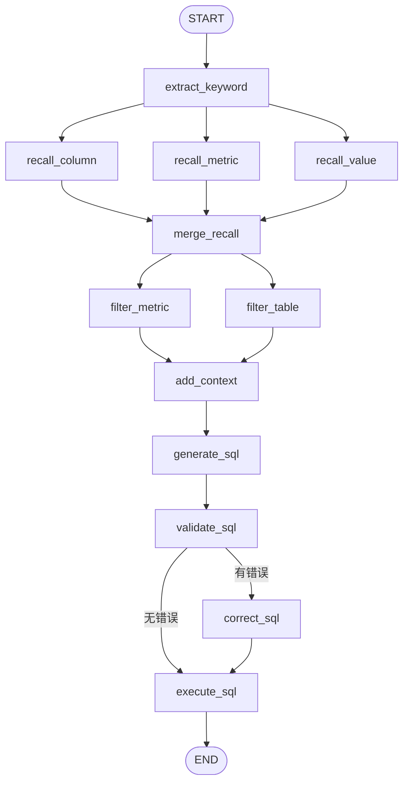

# 掌柜问数 · Data Agent

用一句中文提问，直接拿到数据答案。

掌柜问数是一个 **NL2SQL（自然语言转 SQL）数据问答系统**：用户输入「统计华北地区销售总额」，系统自动完成语义理解、元数据召回、SQL 生成、校验纠错，并在数据仓库中执行，前端实时展示推理过程与结果表格。

```
用户提问 ──▶ 关键词提取 ──▶ 三路并行召回 ──▶ 合并/过滤 ──▶ 生成 SQL ──▶ 校验 ──▶ 执行 ──▶ 结果表格
                                                    ▲                     │
                                                    └────── 自动纠错 ◀─────┘
```

---

## 核心能力

| 能力 | 说明 |
|------|------|
| 自然语言问答 | 无需手写 SQL，支持聚合、分组、排序、TopN 等常见分析诉求 |
| 三路并行召回 | 同时召回「字段」「指标」「字段取值」，兼顾语义相似与精确匹配 |
| 语义层驱动 | 表、字段、指标的描述与别名集中定义在 YAML，构建成元数据库后供检索 |
| SQL 自校验纠错 | 生成后先校验语法/语义，不通过则由大模型基于错误信息重写 |
| 全链路可视化 | 通过 SSE 推送 12 个执行阶段，前端逐步点亮，结果以表格呈现 |
| 指标可扩展 | GMV、AOV 等指标只是 YAML 中的预定义项，不定义也能靠字段语义召回 |

---

## 系统架构



---

## 端到端链路（以「统计华北地区销售总额」为例）

| 步骤 | 做了什么 | 用到的东西 |
|------|----------|-----------|
| 1. 提取关键词 | 分词并扩展同义词，得到 `销售总额 / 华北 / 地区` | 大模型 + 扩展提示词 |
| 2. 召回字段 | 关键词向量化，检索最相似的字段 | Qdrant `column_collection` |
| 3. 召回指标 | 同上，检索业务指标 | Qdrant `metric_collection` |
| 4. 召回取值 | 用「华北」做全文检索，定位到 `dim_region.region_name = '华北'` | Elasticsearch `value_index` |
| 5. 合并召回 | 三路结果去重、按表聚合 | — |
| 6. 过滤指标 | 判断用户真正问的指标（此处为 GMV） | 大模型 |
| 7. 过滤表 | 从候选表中筛出必要表（`fact_order` + `dim_region`） | 大模型 |
| 8. 补充上下文 | 注入当天日期、数据库方言、字段示例值 | meta + 系统信息 |
| 9. 生成 SQL | 基于表结构、字段描述、取值样例生成 SQL | 大模型 |
| 10. 校验 SQL | 语法/字段/方言校验 | SQL 解析 |
| 11. 执行 SQL | 在数据仓库执行，返回结果集 | MySQL `dw` |
| 12. 输出 | 以 SSE 事件返回 `{"stage": ...}` 与 `{"result": [...]}` | — |

> 第 10 步校验不通过时，会先走 `correct_sql` 节点让大模型带着错误信息重写，再进入执行。

---

## 三层存储设计

系统把「业务语义」和「业务数据」分开存放，查询时先查语义、再查数据。

### 1. MySQL · meta（语义层）

| 表 | 内容 |
|----|------|
| `table_info` | 表的名称、类型（fact/dim）、描述 |
| `column_info` | 字段名称、类型、角色、描述、别名、**10 条示例值**、所属表 |
| `metric_info` | 指标名称、描述、关联字段、别名（如 GMV、AOV） |
| `column_metric` | 字段与指标的多对多关联 |

### 2. Qdrant（语义向量库）

| 集合 | 内容 |
|------|------|
| `column_collection` | 字段的 name / description / 每个 alias 各生成一个向量点，共享同一份 payload |
| `metric_collection` | 指标的 name / description / 每个 alias 各生成一个向量点 |

向量维度 1024（bge-large-zh-v1.5），余弦距离；检索相似度阈值 0.6。

### 3. Elasticsearch（字段取值索引）

索引 `value_index`，仅对配置了 `sync: true` 的字段建立：

- `value` 使用 `ik_max_word` 分词，用于匹配用户问题中的具体值（地名、商品名等）
- `column_id` / `table_id` 等为 keyword 字段，用于反查字段归属
- 建库时按字段读取**全部取值**（上限 10 万条），而不是 meta 中的 10 条示例

### 4. MySQL · dw（数据仓库）

标准星型模型：

- 维度表：`dim_region`、`dim_customer`、`dim_product`、`dim_date`
- 事实表：`fact_order`（订单粒度，含金额、数量、外键）

---

## 元数据知识库如何构建

入口：`app/scripts/build_meta_knowledge.py`



一句话：**YAML 是唯一事实来源**，运行构建脚本后，三套存储自动同步；后续新增表/字段/指标，改 YAML 重新构建即可。

---

## LangGraph 工作流



- `extract_keyword` 之后三路召回**并行执行**，由 LangGraph 自动调度
- `filter_metric` 与 `filter_table` 同样并行，汇合到 `add_context`
- 每个节点通过 `runtime.stream_writer` 推送阶段事件，最终由 SSE 转发给前端

---

## 模块职责

| 目录 | 职责 |
|------|------|
| `app/api` | 路由、请求模型、依赖注入（`/query` 接口） |
| `app/agent` | LangGraph 图定义、状态（State）、上下文（Context）、12 个节点 |
| `app/services` | 业务编排：`QueryService`（在线问答）、`MetaKnowledgeService`（离线建库） |
| `app/repositories` | 各存储的读写封装（MySQL / Qdrant / ES） |
| `app/models` | 各存储对应的实体模型（ORM / 文档 / 向量 payload） |
| `app/clients` | 客户端管理器，统一初始化与释放连接 |
| `app/conf` | 配置加载（`app_config.yaml`、`meta_config.yaml`） |
| `app/prompt` | 提示词加载器 |
| `prompts/` | 8 个提示词模板（关键词扩展、过滤、生成、纠错等） |
| `app/scripts` | 运维脚本（构建知识库） |
| `docker/` | MySQL / Qdrant / Elasticsearch / Kibana / TEI 的编排与初始化 SQL |

---

## 技术栈

| 层次 | 选型 |
|------|------|
| Web 后端 | FastAPI + Uvicorn，SSE 流式输出 |
| Agent 编排 | LangGraph（StateGraph，条件边 + 并行分支） |
| 大模型 | 阿里云 Qwen Flash（OpenAI 兼容接口） |
| 向量化 | bge-large-zh-v1.5（TEI 部署，1024 维） |
| 向量库 | Qdrant |
| 全文检索 | Elasticsearch 8（ik_max_word 分词） |
| 关系库 | MySQL 8（meta / dw 两个库） |
| 前端 | Vue 3 + Vite |
| 包管理 | uv（后端）、npm（前端） |

---

## 快速开始

```bash
# 1. 启动中间件（MySQL 3307 / ES 9200 / Qdrant 6333 / TEI 8081）
cd docker && docker compose up -d

# 2. 构建元数据知识库
cd ../data-agent && uv run python -m app.scripts.build_meta_knowledge

# 3. 启动前后端
start.bat
```

Windows 下 `start.bat` 一键拉起 Docker、后端（8001）与前端（5173）；`stop.bat` 一键停止。

浏览器打开 <http://localhost:5173>，试试这些问题：

- 统计华北地区销售总额
- 统计 2025 年各地区销售总额
- 统计 2025 年各个商品的销量
- 统计各地区销量排名前三的商品

> 配置集中在 `conf/app_config.yaml`（数据库、ES、Qdrant、LLM），其中包含连接密钥，公开仓库中请改为环境变量注入。

---

## 目录结构

```
data-agent/
├── app/
│   ├── agent/            # LangGraph 图、状态、上下文、节点
│   │   └── nodes/        # 12 个执行节点
│   ├── api/              # 路由 / schema / 依赖注入
│   ├── clients/          # MySQL / Qdrant / ES / Embedding 客户端管理
│   ├── conf/             # 配置模型与加载
│   ├── core/             # 日志等基础设施
│   ├── models/           # 实体模型（mysql / qdrant / es）
│   ├── prompt/           # 提示词加载器
│   ├── repositories/     # 持久层
│   ├── scripts/          # 知识库构建脚本
│   └── services/         # 业务服务
├── conf/                 # app_config.yaml / meta_config.yaml
├── docker/               # compose 编排与初始化 SQL
├── prompts/              # 提示词模板
├── main.py               # FastAPI 入口
├── start.bat / stop.bat  # 一键启停
└── pyproject.toml        # 依赖声明（uv）
```

---

## 设计取舍

- **为什么不把全部字段值塞进向量库？** 取值数量大且需要精确匹配，用 ES 全文检索比向量检索更准、更省。
- **为什么 meta 只存 10 条示例值？** 示例是给大模型「看字段长什么样」的上下文，不是检索数据源。
- **为什么召回要分三路？** 字段、指标、取值是三件不同的事，分开检索再合并，避免互相干扰，也能并行提速。
- **为什么 SQL 要二次校验？** 大模型生成的 SQL 可能引用不存在的字段或方言不兼容，校验 + 纠错能显著降低执行失败率。